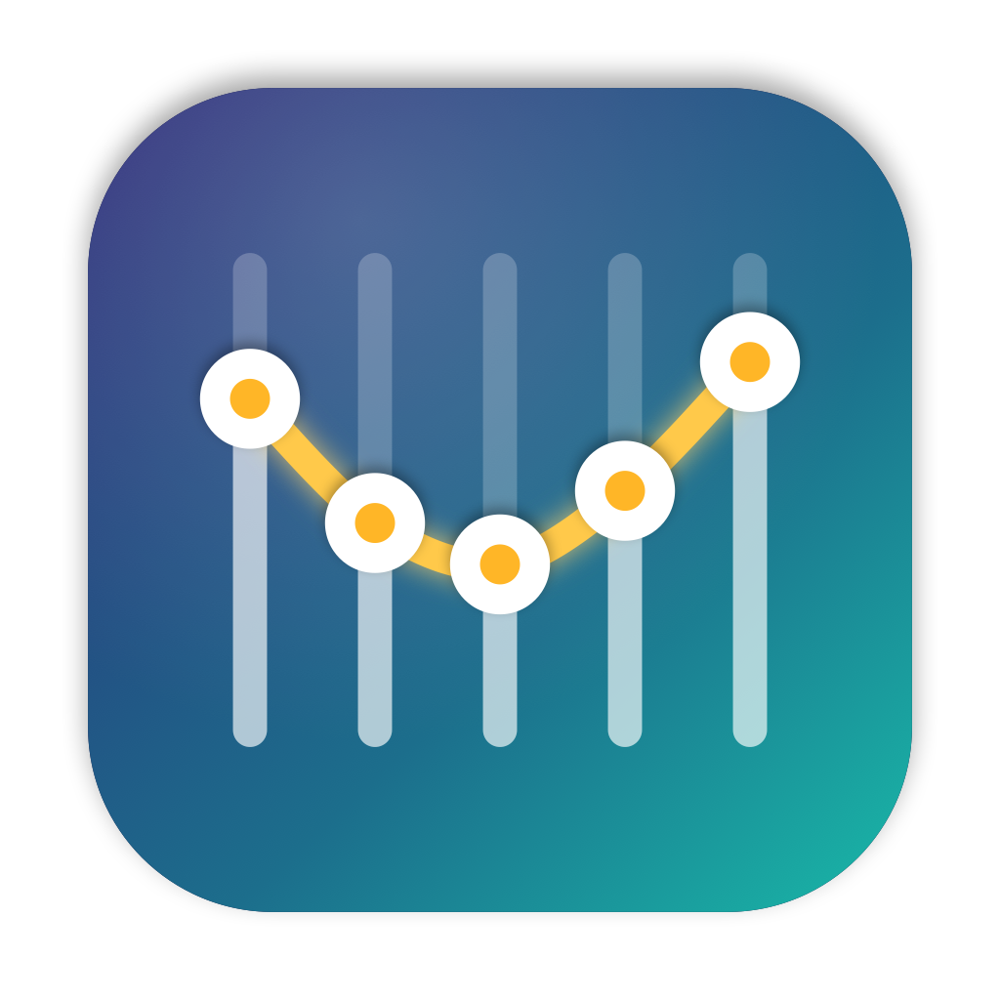

<p align="center">
  
</p>

<h1 align="center">HeyEQQ</h1>

<p align="center">
  <strong>A system-wide equalizer for macOS, right in your menu bar.</strong><br>
  Shape the sound of every app: music, videos, games and calls. No audio driver to install.
</p>

<p align="center">
  <a href="https://github.com/mohammadmotallebi/HeyEQQ/releases/latest"></a>
  
  
  <a href="https://github.com/mohammadmotallebi/HeyEQQ/actions/workflows/ci.yml"></a>
  <a href="LICENSE"></a>
  <a href="https://buymeacoffee.com/mohamadmot5"></a>
</p>

---

HeyEQQ captures the sound of every app with the Core Audio process taps built into macOS, runs it
through a high-quality equalizer and plays it to your speakers or headphones. Start with three
simple sliders, or go all the way to a 32-band parametric EQ with headphone correction and per-app settings.

## Download & install

**Requirements:** macOS 15 Sequoia or newer, on an Apple Silicon or Intel Mac.

1. Download `HeyEQQ-<version>.dmg` from the [Releases](../../releases) page.
2. Open the DMG and drag **HeyEQQ** onto the **Applications** folder.
3. Open HeyEQQ from Applications. The first launch is blocked; see below.

### First launch: "Apple could not verify HeyEQQ"

HeyEQQ is not notarized by Apple yet, so macOS blocks it the first time. To allow it once:

1. Open HeyEQQ and click **Done** (not "Move to Trash") on the warning.
2. Open **System Settings › Privacy & Security** and scroll down to Security.
3. Next to "HeyEQQ was blocked…", click **Open Anyway** and confirm with your password or Touch ID.

On macOS 15 and newer, right-clicking the app and choosing Open no longer gets past this warning.

If you prefer the Terminal, this does the same thing:

```sh
xattr -dr com.apple.quarantine /Applications/HeyEQQ.app
```

### Allow System Audio Recording

On first start macOS asks whether HeyEQQ may record system audio. Click **Allow**: HeyEQQ needs
this to capture the sound it equalizes. The audio stays on your Mac; nothing is recorded or sent anywhere.

macOS may ask again after you install an update; just allow it again.

If you missed the prompt, or the level meter stays empty while music plays: **System Settings ›
Privacy & Security › Screen & System Audio Recording**, and turn on HeyEQQ under "System Audio
Recording Only".

### Built-in speakers are off by default

HeyEQQ doesn't run on the Mac's own speakers until you allow it. Strong bass boosts at high volume
can damage small laptop speakers. To use it there anyway, click **Turn On with Protection…** in the
menu, or go to **Settings › Built-in Speakers**. With protection on, bass below 250 Hz is limited
to +6 dB, and nothing plays louder than it would without the EQ. Headphones and external speakers
are not limited.

### Uninstall

Quit HeyEQQ from its menu and move `/Applications/HeyEQQ.app` to the Trash. You can also delete
its settings: `~/Library/Application Support/HeyEQQ` and `~/Library/Preferences/com.heyeqq.app.plist`.

## Features

**Three modes**

| Mode | What you get |
|---|---|
| Simple | Bass, mid and treble sliders and 7 presets, right in the menu bar popover |
| Advanced | 10-band graphic EQ with preamp, response curve, 12 built-in presets and your own presets |
| Expert | Parametric EQ with up to 32 bands, 7 filter types and a draggable graph; AutoEQ / Equalizer APO import and export; saved curves |

**Sound**
- **Per-app EQ and volume:** give an app its own curve, no EQ at all, or a lower volume (Expert › Per-App).
- **Headphone correction:** search about 9,000 headphone models from the AutoEQ project and import a correction curve. HeyEQQ suggests one when you connect a matching device.
- **Per-device presets:** each output device remembers its own mode and preset and switches automatically.
- **Sound Quality settings:** Loud or Clean output (Clean lowers the level so boosts never clip), a smooth look-ahead limiter, a Clarity control, and Accurate treble (more precise high-frequency filters).
- **Limiter indicator** with a one-click **Fix**, which lowers the preamp just enough to stop limiting.
- **Balance and mono** for one-sided hearing or one earbud.
- **Surround output:** 5.1 / 7.1 devices are equalized on every channel (up to 16).

**Convenience**
- Live sound bar and spectrum analyzer.
- **Bypass** to compare with and without the EQ: ⌥⌘E from anywhere. Shortcuts for bypass and next/previous preset can be changed in Settings.
- Follows output changes (headphones, AirPods, Bluetooth) automatically, or stays pinned to a chosen device.
- Launch at login.

## Privacy

HeyEQQ processes audio on your Mac and never records or uploads it. The only network requests
fetch public AutoEQ data from GitHub: the headphone list (at most once a week) for search and
suggestions, and the correction curve you choose to import. Device names are matched against that list on your Mac and are never sent anywhere.
You can turn suggestions off in Settings › General.

## Build from source

You need macOS 15 or newer and Xcode 26 or newer (the Liquid Glass UI needs the macOS 26 SDK).
See [CONTRIBUTING.md](CONTRIBUTING.md) for guidelines.

```sh
scripts/build-app.sh --install   # build, sign, install to /Applications, launch
scripts/build-app.sh --open      # build build/HeyEQQ.app and launch it from there
UNIVERSAL=1 scripts/build-app.sh # Apple Silicon + Intel binary
swift test                       # DSP and model tests
swift run HeyEQQSpike            # terminal test tool (see Spike/README.md)
swift scripts/make-icons.swift   # regenerate the app and menu-bar icons
```

`build-app.sh` signs with the first "Apple Development" identity in your keychain, or ad hoc
if there is none. Ad hoc signing works, but macOS asks for the audio permission again after every rebuild.
Use `SIGN_IDENTITY="<name or SHA-1>"` to pick an identity.

### Releases

```sh
scripts/release.sh                                        # Developer ID sign, DMG, notarize, staple
DEVELOPER_ID="<identity>" SKIP_NOTARIZE=1 scripts/release.sh  # signed DMG without notarization
```

`release.sh` builds a universal app with hardened runtime and writes `build/HeyEQQ-<version>.dmg`.
Notarization needs a Developer ID Application certificate and a `notarytool` keychain profile
(`HeyEQQ-notary`); the steps are at the top of the script. The version comes from `Support/Info.plist`.
`AD_HOC=1 scripts/release.sh` builds the current public downloads: ad-hoc signed (no certificate) and not notarized.

### Layout

- `Sources/HeyEQQCore/`: the audio pipeline and DSP.
  - `SystemAudioTap`: process tap plus private aggregate device.
  - `EQEngine`: lifecycle, device changes, per-app pipelines, built-in speaker protection.
  - `EQProcessor`: real-time EQ, stereo stage, limiter.
  - `EQCurve` and `Biquad`: filter model and math.
  - `EqualizerAPO`: import and export.
  - `AutoEQIndex`, `SpectrumAnalyzer`, `OutputDevices`, `AudioProcesses`, `InstanceGuard`.
- `Sources/HeyEQQ/`: the SwiftUI app.
  - `MenuBarExtra` popover, Equalizer window and settings pane.
  - `AppModel` (settings in UserDefaults; presets and curves in `~/Library/Application Support/HeyEQQ/`).
- `Tests/HeyEQQCoreTests/`: Swift Testing tests.
- `Spike/`: the original terminal prototype, still useful for testing the pipeline.
- `Support/`: Info.plist, entitlements and the generated icons.
- `scripts/`: build, release and icon scripts.

### How it works

A global process tap captures the output of every app except HeyEQQ and mutes the original.
A private aggregate device clocked by the real output device feeds that audio through the EQ and plays it.
Per-app rules get their own tap and pipeline. Turning HeyEQQ off removes the tap, so system audio is
untouched and no CPU is used.

Surround: when the default output device's first stream has more than 2 channels, HeyEQQ captures
that stream at full channel count instead of a stereo mixdown. Devices that split channels over
several 2-channel streams stay on the stereo path. For debugging,
`defaults write com.heyeqq.app forceDeviceStreamTap -bool YES` forces this path on any device.

## Support HeyEQQ

HeyEQQ is free and open source, built in my spare time. If it made your music sound better,
you can buy me a coffee. It helps pay for new features, testing on more devices and, one day,
an Apple Developer account so the app opens without any warnings. Thank you! ☕🎧

<a href="https://buymeacoffee.com/mohamadmot5"></a>

Not in a position to donate? A ⭐ on GitHub, a bug report or telling a friend helps just as much.

## Changelog

See [CHANGELOG.md](CHANGELOG.md) for what's new in each version.

## License

HeyEQQ is released under the [MIT License](LICENSE).

## Credits

- Headphone correction data: [AutoEQ](https://github.com/jaakkopasanen/AutoEq) by Jaakko Pasanen.
- App and menu-bar icons: original artwork, generated by `scripts/make-icons.swift`.
- Filter design: RBJ Audio EQ Cookbook; matched second-order filters after M. Vicanek.
